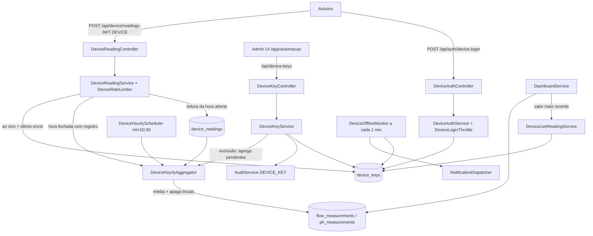

# Integração Arduino (chaves de dispositivo) Design

**Spec**: `.specs/features/arduino-device-keys/spec.md`
**Status**: Draft

A abordagem de armazenamento (tabela bruta nova + média horária nas tabelas atuais) foi decidida e confirmada pelo usuário no grilling (Q18/Q26), então não há exploração de alternativas aqui. Não existe `.specs/STATE.md` nem lições confirmadas, portanto não há decisão prévia a respeitar.

---

## Architecture Overview

Pacote novo `br.com.carbonifera.ete.device` no backend. O Arduino entra por um papel novo (`DEVICE`) que só alcança `POST /api/device/readings`. As leituras de 1 minuto vão para `device_readings`; uma rotina horária as consolida em registros normais de `flow_measurements`/`ph_measurements`, que o resto do sistema já sabe ler. Os últimos valores ao vivo ficam na própria linha da chave e só o dashboard os usa.



Fluxo de uma leitura:

1. `device-login` valida o hash da chave, emite JWT `DEVICE` (subject `device:<id>`, claims `role`, `deviceKeyId`, `stationId`).
2. `JwtAuthenticationFilter` vê `role=DEVICE`, carrega a chave do banco e só autentica se ela existir e estiver ativa (desativar/excluir vale na requisição seguinte).
3. `SecurityConfig` restringe `/api/device/readings` a `DEVICE` e todas as demais rotas protegidas aos quatro papéis humanos.
4. `DeviceReadingService` valida, aplica o limite, grava a leitura (ou funde na média da hora fechada) e atualiza os valores ao vivo e o último envio.

---

## Code Reuse Analysis

### Existing Components to Leverage

| Component | Location | How to Use |
| --------- | -------- | ---------- |
| `FlowRateCalculator` | `backend/src/main/java/br/com/carbonifera/ete/measurement/FlowRateCalculator.java` | Calcula `flowLiters` de cada leitura e da média |
| `FlowMeasurement`, `PhMeasurement` e repositórios | `.../measurement/` | Recebem a média horária; ganham colunas de dispositivo |
| `AuditService`, `AuditEvent` | `.../audit/` | Eventos `DEVICE_KEY`; consulta de evento UPDATED para "hora editada" |
| `JwtService`, `JwtAuthenticationFilter`, `SecurityConfig` | `.../security/` | Token e filtro do DEVICE; regra por papel |
| `OperatorAuthorshipPolicy`, repositórios `findForList` | `.../security/`, `.../measurement/` | Operador passa a ver e alterar registros sem autor humano da própria ETE |
| `NotificationDispatcher`, `NotificationCommand`, `NotificationRecipientResolver`, `LimeMinStockMonitor` | `.../notification/`, `.../lime/` | Alerta de sem sinal (padrão monitor + dedupe) |
| `SchedulingConfig.APP_ZONE`, bean `Clock` | `.../config/SchedulingConfig.java` | Fuso e tempo injetável nos testes |
| `OperatorAccessProperties` | `.../config/` | Molde para `DeviceProperties` (`@ConfigurationProperties` record) |
| `SensitiveConfigurationValidator` | `.../config/` | Validar `DEVICE_KEY_ENCRYPTION_SECRET` |
| `StationService.requireStation` | `.../station/` | Resolver a ETE da chave |
| `UsersAdminPage.tsx`, `userApi.ts`, `LoginPage.tsx` (Eye/EyeOff) | `frontend/src/` | Molde de tela admin, cliente de API e toggle de visibilidade |
| `MorePage.tsx`, `permissions.ts`, `App.tsx` | `frontend/src/` | Botão, permissão ADMIN e rota |

### Integration Points

| System | Integration Method |
| ------ | ------------------ |
| Banco (Postgres, `ddl-auto: update` + `schema.sql`) | Entidades novas criadas pelo Hibernate; `schema.sql` remove NOT NULL de `created_by_id` e recria os checks de enum de `audit_events` e `notifications` |
| Dashboard | `DashboardService.latest*` consulta `DeviceLiveReadingService` e escolhe o valor mais recente |
| Notificações | Novos tipos `DEVICE_OFFLINE_ALERT` e `DEVICE_BACK_ONLINE` |
| Frontend de medições | Resposta continua com `createdByName`; para registro de equipamento vem "Equipamento: <nome>" e `createdById` nulo |

---

## Components

### DeviceKey (entidade) e DeviceKeyRepository

- **Purpose**: Guardar a chave, o estado, o último envio e os últimos valores ao vivo.
- **Location**: `.../device/DeviceKey.java`, `DeviceKeyRepository.java`
- **Interfaces**:
  - `findByValueHash(String): Optional<DeviceKey>` - login
  - `existsByStationAndNameKey(Station, String): boolean` - unicidade (nome em minúsculas)
  - `findAllByStationInAndActiveTrue`, `findAllByActiveTrueAndLastSeenAtIsNotNull` - monitor e dashboard
  - `findLiveByStations(List<Station>)` - leituras ao vivo do dashboard
- **Dependencies**: `Station`
- **Reuses**: padrão de entidade UUID de `FlowMeasurement`

### DeviceKeyGenerator, DeviceKeyCipher, DeviceKeyHasher

- **Purpose**: Gerar a chave de 24 caracteres, cifrar/decifrar (AES-GCM) e calcular o hash SHA-256.
- **Location**: `.../device/`
- **Interfaces**:
  - `DeviceKeyGenerator.generate(): String` - `SecureRandom`, 1+ de cada classe, símbolos `!@#$%^&*-_=+?`, embaralhado
  - `DeviceKeyCipher.encrypt(String): String` / `decrypt(String): String` - IV de 12 bytes aleatório prefixado, Base64; chave AES-256 = SHA-256 do segredo
  - `DeviceKeyHasher.hash(String): String` - hex minúsculo
- **Dependencies**: `DeviceProperties`

### DeviceKeyService e DeviceKeyController

- **Purpose**: CRUD de chaves, restrito a ADMIN.
- **Location**: `.../device/`
- **Interfaces**:
  - `GET /api/device-keys` - lista (sem valor)
  - `POST /api/device-keys` `{name, stationId}` - cria; resposta traz o item sem valor
  - `GET /api/device-keys/{id}/secret` - `{value}` sob demanda, sem auditoria
  - `PATCH /api/device-keys/{id}/active` `{active}` - desativar/reativar (auditado)
  - `DELETE /api/device-keys/{id}` - exclui; agrega pendentes antes (auditado)
  - `@PreAuthorize("hasRole('ADMIN')")` em todas
- **Dependencies**: `DeviceKeyRepository`, `DeviceKeyGenerator`, `DeviceKeyCipher`, `DeviceKeyHasher`, `AuditService`, `DeviceHourlyAggregator`, `StationService`, `CurrentUserService`
- **Reuses**: `AuditService.recordUpdate/recordDelete` (descrição fixa com 10+ caracteres), `BusinessException` (409 para nome duplicado)

### DeviceAuthController, DeviceAuthService, DeviceLoginThrottle

- **Purpose**: Login do Arduino por chave e proteção contra tentativas.
- **Location**: `.../device/` e rota em `/api/auth/device-login`
- **Interfaces**:
  - `POST /api/auth/device-login` `{key}` -> `{accessToken, tokenType, expiresInSeconds}`
  - `DeviceLoginThrottle.isBlocked(ip)`, `recordFailure(ip)`, `recordSuccess(ip)` - 10 falhas/5 min bloqueiam 15 min, `ConcurrentHashMap`, `Clock` injetado
  - IP lido de `request.getRemoteAddr()` (o proxy reverso deve repassar o IP real; ver Riscos)
- **Dependencies**: `DeviceKeyRepository`, `DeviceKeyHasher`, `JwtService`
- **Reuses**: nada de `AuthService` (fluxo separado, sem usuário)

### JwtService (extensão) e JwtAuthenticationFilter (extensão)

- **Purpose**: Emitir e autenticar o JWT do DEVICE.
- **Location**: `.../security/`
- **Interfaces**:
  - `JwtService.generateDeviceAccessToken(DeviceKey): String` - subject `device:<id>`, claims `role=DEVICE`, `deviceKeyId`, `stationId`, `tokenType=access`
  - `JwtService.isDeviceToken(String): boolean`, `deviceKeyId(String): UUID`
  - Filtro: se `isDeviceToken` carrega a chave pelo id, exige `active`, monta `DevicePrincipal` com autoridade `ROLE_DEVICE`; senão, fluxo atual
- **Dependencies**: `DeviceKeyRepository`
- **Reuses**: `JwtService.parseClaims`

### DevicePrincipal

- **Purpose**: Principal do Arduino (`UserDetails`) com `deviceKeyId`, `stationId`, `name`.
- **Location**: `.../security/DevicePrincipal.java`

### SecurityConfig (alteração)

- **Purpose**: Isolar o DEVICE.
- **Interfaces**: `permitAll` em `POST /api/auth/device-login`; `POST /api/device/readings` -> `hasRole('DEVICE')`; `anyRequest()` -> `hasAnyRole('OPERATOR','SUPERVISOR','ADMIN','VIEWER')` (substitui `authenticated()`); `/api/device-keys/**` já cai na regra dos humanos e o `@PreAuthorize` exige ADMIN.

### DeviceReadingController e DeviceReadingService

- **Purpose**: Receber o POST único, validar, limitar e gravar.
- **Location**: `.../device/`
- **Interfaces**:
  - `POST /api/device/readings` `{heightCm?, rawPh?, treatedPh?, measuredAt?}` -> `{accepted:[...], rejected:[{field, reason}], discarded:[...]}`
  - `DeviceReadingService.ingest(DevicePrincipal, DeviceReadingRequest): DeviceReadingResponse`
  - `DeviceRateLimiter.tryAcquire(UUID keyId): boolean` - janela fixa de 1 minuto, limite configurável (padrão 10), `Clock` injetado
- **Dependencies**: `DeviceKeyRepository`, `DeviceReadingRepository`, `DeviceHourlyAggregator`, `FlowRateCalculator`, `Clock`
- **Reuses**: faixas de `FlowMeasurementRequest` (0–45, 2 casas) e `PhMeasurementRequest` (0–14, 2 casas) validadas com `BigDecimal` no serviço, para ignorar campo inválido sem derrubar o corpo
- Classificação por leitura: se o fim da janela da hora > agora, insere bruta; senão, se a hora fechou há mais de 24 h, descarta; senão, delega a `DeviceHourlyAggregator.mergeLate` (que insere bruta quando ainda não há média da hora).

### DeviceReading (entidade) e DeviceReadingRepository

- **Purpose**: Leitura bruta de 1 minuto, de vida curta.
- **Location**: `.../device/`
- **Interfaces**:
  - `findPendingBefore(Instant hourStart)` e `findByDeviceKeyAndTypeAndMeasuredAtBetween`
  - `deleteAllByIdIn(...)` / `deleteByDeviceKey(DeviceKey)`
- **Dependencies**: `DeviceKey`

### DeviceHourlyAggregator

- **Purpose**: Núcleo do domínio. Cria ou funde a média horária e apaga as leituras brutas na mesma transação.
- **Location**: `.../device/DeviceHourlyAggregator.java`
- **Interfaces**:
  - `aggregateClosedHours(Instant now)` - agrupa as brutas de horas fechadas por chave/tipo/hora e chama `applyGroup`; cada grupo em transação própria (`REQUIRES_NEW` via bean auxiliar) para uma falha não parar os demais
  - `aggregateKeyIncludingPartial(DeviceKey, Instant now)` - usado na exclusão; `measuredAt` da hora parcial = `now`
  - `mergeLate(DeviceKey, ReadingType, Instant measuredAt, value, Instant now): MergeOutcome` - `MERGED | RAW_STORED | DISCARDED_EDITED | DISCARDED_DELETED | DISCARDED_TOO_OLD`
  - `windowEnd(Instant): Instant` - fim da janela em `America/Sao_Paulo`
  - `applyGroup`: se já existe registro com `device_window_end` e chave/tipo -> aplica regra de reabertura (descarta se `deleted` ou se há `AuditEvent` UPDATED; senão média ponderada `(m×n + soma)/(n + k)`, `sample_count += k`); se não existe -> cria registro com média, `sample_count`, `device_key`, `device_name`, `device_window_end`, `measuredAt = min(windowEnd, now)`, `created_by` nulo
- **Dependencies**: `DeviceReadingRepository`, `FlowMeasurementRepository`, `PhMeasurementRepository`, `AuditEventRepository`, `FlowRateCalculator`, `Clock`
- **Reuses**: `SchedulingConfig.APP_ZONE`

### DeviceHourlyScheduler

- **Purpose**: Disparar a agregação a cada hora.
- **Location**: `.../device/DeviceHourlyScheduler.java`
- **Interfaces**: `@Scheduled(cron = "30 0 * * * *", zone = "America/Sao_Paulo") void run()` chama `aggregateClosedHours`; o catch-up vem do próprio filtro "todas as horas fechadas pendentes"
- **Reuses**: padrão de `NotificationScheduler`

### DeviceLiveReadingService

- **Purpose**: Entregar ao dashboard o valor ao vivo mais recente por tipo.
- **Location**: `.../device/DeviceLiveReadingService.java`
- **Interfaces**: `latestFlow(List<Station>)`, `latestRawPh(List<Station>)`, `latestTreatedPh(List<Station>)` -> `Optional<DashboardMeasurementResponse>`
- **Dependencies**: `DeviceKeyRepository`
- **Reuses**: `DashboardMeasurementResponse`

### DashboardService (alteração)

- **Purpose**: `latestFlow/latestRawPh/latestTreatedPh` passam a comparar o registro das tabelas com o valor ao vivo e devolver o de `measuredAt` maior. Séries, médias e totais não mudam.
- **Location**: `.../dashboard/DashboardService.java:~390` (métodos `latest*`)

### Medições (alterações)

- **Purpose**: Autoria opcional e campos de dispositivo.
- **Location**: `.../measurement/FlowMeasurement.java`, `PhMeasurement.java`, `*Response.java`, `*Repository.java`, `*Service.java`
- **Interfaces**:
  - `createdBy` nulo permitido; novos campos `deviceKey` (`ManyToOne` nulável), `deviceName`, `deviceWindowEnd`, `sampleCount`
  - Respostas: `createdById` nulo e `createdByName = "Equipamento: " + deviceName` quando não há autor; campos novos `deviceName` e `sampleCount`
  - Repositórios: filtro de autor vira `(:createdById is null or createdBy.id = :createdById or createdBy is null)` para o operador ver registros de equipamento
  - `findByDeviceKeyAndDeviceWindowEnd...` para a lógica de reabertura
  - Índice único por `(device_key_id, device_window_end)` (vazão) e `(device_key_id, type, device_window_end)` (pH)
  - `DeviceKeyService.delete` anula `device_key_id` nos registros por UPDATE JPQL antes de apagar a chave
- **Reuses**: `FlowMeasurementService.update/delete` sem mudança de regra

### OperatorAuthorshipPolicy (alteração)

- **Purpose**: `assertOwned` aceita `createdBy == null` (registro de equipamento); a checagem de ETE continua em `StationScopeService.requireWritableStation`.
- **Location**: `.../security/OperatorAuthorshipPolicy.java:30`

### AuditService / AuditRecordType (alteração)

- **Purpose**: Novo `DEVICE_KEY`; `resolveRecordStation` é um `switch` exaustivo e precisa do novo caso (histórico de chave devolve a ETE da chave, ou 404 se excluída).
- **Location**: `.../audit/AuditRecordType.java`, `AuditService.java:~116`
- **Interfaces**: `AuditEventRepository.existsByRecordTypeAndRecordIdAndAction(...)` para "hora editada"

### DeviceOfflineMonitor, DeviceProperties, notificações

- **Purpose**: Alerta de sem sinal e de retorno.
- **Location**: `.../device/DeviceOfflineMonitor.java`, `.../config/DeviceProperties.java`, `NotificationType`, `NotificationRecipientResolver`
- **Interfaces**:
  - `@Scheduled(fixedRate = 60000)` chama `evaluate(Instant now)`
  - Alerta quando `active && lastSeenAt != null && lastSeenAt < now - offlineMinutes && offlineNotifiedForSeenAt != lastSeenAt`; grava `offlineNotifiedForSeenAt = lastSeenAt`; `dedupeKey = "DEVICE_OFFLINE|<keyId>|<lastSeenAt>"`
  - Retorno: `offlineNotifiedForSeenAt != null && lastSeenAt > offlineNotifiedForSeenAt` -> `DEVICE_BACK_ONLINE`, limpa o campo
  - `NotificationRecipientResolver.deviceAlertRecipients(Station)` = supervisores + admins ativos + operadores ativos da ETE (`findAllByRoleAndStationAndActiveTrue`)
  - `DeviceProperties(app.device)`: `encryptionSecret`, `offlineMinutes` (5), `rateLimitPerMinute` (10)
- **Reuses**: `LimeMinStockMonitor` como molde

### Configuração

- **Purpose**: Segredo e propriedades novas.
- **Location**: `application.yml`, `application-test.yml`, `.env.example`, `docker-compose.yml`, `SensitiveConfigurationValidator`
- **Interfaces**: env `DEVICE_KEY_ENCRYPTION_SECRET` (obrigatória, mínimo 32 caracteres, placeholder `replace_with_a_random_device_key_secret_with_32_chars` proibido), `DEVICE_OFFLINE_MINUTES`, `DEVICE_RATE_LIMIT_PER_MINUTE`
- `schema.sql`: `ALTER TABLE flow_measurements ALTER COLUMN created_by_id DROP NOT NULL`, o mesmo para `ph_measurements`, e `DROP CONSTRAINT IF EXISTS` + `ADD CONSTRAINT` para `audit_events_record_type_check` e `notifications_type_check`

### Frontend

- **Purpose**: Tela de gerenciamento, botão em Mais e tratamento de autoria nula.
- **Location**: `frontend/src/pages/AutomationPage.tsx`, `services/deviceKeyApi.ts`, `utils/deviceKeys.ts`, `auth/permissions.ts`, `pages/MorePage.tsx`, `App.tsx`, `types.ts`, `utils/apiAdapters.ts`, `styles.css`
- **Interfaces**:
  - `canManageDeviceKeys(role)` -> ADMIN
  - `utils/deviceKeys.ts`: `isDeleteConfirmed(text)` (exatamente `EXCLUIR`), `deviceStatus(lastSeenAt, now, offlineMinutes)` -> `online | offline | never`, `SECRET_VISIBLE_MS = 15000`
  - `AutomationPage`: lista (nome, ETE, último envio, selo), formulário de nova chave (nome + ETE), por linha: ver (Eye/EyeOff, oculta após 15 s), copiar (`navigator.clipboard`, sem exibir), desativar/reativar (confirmação), excluir (confirmação + campo EXCLUIR)
  - `types.ts`/`apiAdapters.ts`: `createdById` e `createdByName` nulos viram rótulo seguro
- **Reuses**: `UsersAdminPage.tsx`, `userApi.ts`, `stationApi.ts`, `PageHeader`, `DataState`, ícones `lucide-react`

---

## Data Models

### DeviceKey (`device_keys`)

```java
class DeviceKey {
  UUID id;
  Station station;            // not null
  String name;                // exibição
  String nameKey;             // lower(name); unique(station_id, name_key)
  String encryptedValue;      // AES-GCM, Base64(iv+cipher)
  String valueHash;           // SHA-256 hex; unique
  boolean active;
  Instant createdAt;
  AppUser createdBy;          // admin que criou
  Instant lastSeenAt;         // nulo até a 1a leitura
  BigDecimal lastHeightCm; BigDecimal lastFlowLiters; Instant lastFlowAt;
  BigDecimal lastRawPh; Instant lastRawPhAt;
  BigDecimal lastTreatedPh; Instant lastTreatedPhAt;
  Instant offlineNotifiedForSeenAt;  // controle do alerta
}
```

### DeviceReading (`device_readings`)

```java
class DeviceReading {
  UUID id;
  DeviceKey deviceKey;        // not null
  DeviceReadingType type;     // FLOW | PH_RAW | PH_TREATED
  BigDecimal value;           // FLOW: heightCm; PH_*: pH
  BigDecimal flowLiters;      // só FLOW
  Instant measuredAt;
  Instant createdAt;
  // índice (device_key_id, type, measured_at)
}
```

### Colunas novas em `flow_measurements` e `ph_measurements`

```java
DeviceKey deviceKey;        // nulável; zerado ao excluir a chave
String deviceName;          // cópia do nome
Instant deviceWindowEnd;    // fim da janela da hora; imutável
Integer sampleCount;        // nulável
// created_by_id passa a nulável
```

**Relationships**: `DeviceKey` N:1 `Station`; `DeviceReading` N:1 `DeviceKey`; medição N:1 `DeviceKey` (nulável).

---

## Error Handling Strategy

| Error Scenario | Handling | User Impact |
| -------------- | -------- | ----------- |
| Chave inválida, desativada ou malformada no login | 401 genérico | Arduino refaz o login |
| IP bloqueado pelo limitador | 429 sem detalhe | Arduino espera 15 min |
| Valor de sensor fora da faixa | Ignora o campo, aceita os demais, lista em `rejected` | Sensor defeituoso não derruba os outros |
| Nenhum valor válido | 400 | Firmware corrige o envio |
| `measuredAt` no futuro | 400 | Firmware corrige o relógio |
| Mais de 10 requisições/min na chave | 429, nada gravado | Firmware reduz a frequência |
| Chave desativada/excluída com JWT ainda válido | 401 no filtro | Arduino refaz login e recebe 401 |
| Leitura de hora editada, excluída ou >24 h | 200, descartada, log | Sem efeito no registro |
| Falha ao agregar um grupo | Log, transação do grupo desfeita, brutas mantidas; demais grupos seguem | Reprocessado na próxima rotina |
| Falha ao decifrar a chave em `/secret` | 500 sem detalhe; login continua pelo hash | Admin gera outra chave |
| Segredo ausente/placeholder | Falha na subida | Operação corrige a configuração |
| Nome duplicado na ETE | 409 | Mensagem na tela |

---

## Risks & Concerns

| Concern | Location (file:line) | Impact | Mitigation |
| ------- | -------------------- | ------ | ---------- |
| `anyRequest().authenticated()` aceitaria um DEVICE em rotas sem `@PreAuthorize` (ex.: `/api/auth/change-password`, notificações), onde `@AuthenticationPrincipal UserPrincipal` seria nulo | `backend/src/main/java/br/com/carbonifera/ete/security/SecurityConfig.java:56` | 500 ou acesso indevido a rota humana | Trocar por `hasAnyRole` dos quatro papéis humanos e restringir `/api/device/readings` a `DEVICE`; teste cobre 403 em rotas amostrais |
| Hibernate `ddl-auto: update` não remove NOT NULL nem atualiza checks de enum | `backend/src/main/resources/schema.sql:5` | Inserir registro sem autor, evento `DEVICE_KEY` ou notificação `DEVICE_*` falharia no Postgres (H2 de teste não detecta) | `schema.sql` ajusta `created_by_id` e recria `audit_events_record_type_check` e `notifications_type_check`; tarefa de verificação manual no Postgres (`\d`) antes do deploy |
| `AuditService.resolveRecordStation` é `switch` exaustivo | `backend/src/main/java/br/com/carbonifera/ete/audit/AuditService.java:116` | Não compila com o novo enum | Incluir o caso `DEVICE_KEY` na mesma tarefa que cria o enum |
| Operador pode editar `measuredAt` da média e, sem coluna própria, a rotina criaria duplicata | `backend/src/main/java/br/com/carbonifera/ete/measurement/FlowMeasurement.java:~75` | Duas médias para a mesma hora | `device_window_end` imutável com índice único |
| Filtro de autor do operador exclui registros sem autor (`createdBy.id = :createdById`) | `backend/src/main/java/br/com/carbonifera/ete/measurement/FlowMeasurementRepository.java:62` | Operador não veria médias do Arduino | `or createdBy is null` nas consultas de lista, com teste de repositório |
| Chave decifrável no banco; vazar o segredo de cifra expõe todas as chaves | `DeviceKeyCipher` (novo) | Falsificação de Arduinos | Segredo só em env; mínimo 32 caracteres; rotação = excluir e gerar chaves de novo (documentar); `/secret` só ADMIN |
| IP do Arduino atrás de proxy reverso aparece como o do proxy no limitador | `DeviceAuthController` (novo) | Bloqueio de todos os Arduinos por falhas de um | Usar `X-Forwarded-For` apenas se o proxy confiável estiver configurado (`server.forward-headers-strategy`); registrar como pendência de implantação |
| Transporte sem TLS expõe a chave no login | Infra | Interceptação da chave | Assunção de HTTPS via proxy; registrar no README de implantação |
| Estado em memória (limitador, rate limit) se perde no restart e não é compartilhado entre instâncias | `DeviceLoginThrottle`, `DeviceRateLimiter` (novos) | Limite zerado após restart | Aceito: 1 instância no `docker-compose`; documentado |
| `DashboardService.currentDayAverages` soma litros do dia (`flowAverages.total()`) | `backend/src/main/java/br/com/carbonifera/ete/dashboard/DashboardService.java:288` | Misturar leituras de 1 minuto inflaria o total | Só médias horárias entram nas tabelas; teste confirma que leituras brutas e valores ao vivo não alteram o total |
| Frontend assume `createdByName` e `createdById` não nulos | `frontend/src/utils/apiAdapters.ts:55` | Quebra ao exibir registro de equipamento | Tipos nulos, rótulo "Equipamento: <nome>" vindo do backend, teste de adaptador |
| Frontend sem biblioteca de teste de componente | `frontend/test-runner.mts` | Tela sem teste automatizado de renderização | Lógica testável isolada em `utils/deviceKeys.ts`; verificação visual no Verifier |

---

## Tech Decisions (only non-obvious ones)

| Decision | Choice | Rationale |
| -------- | ------ | --------- |
| Valores ao vivo | Colunas na linha de `device_keys` | Nunca apagados pela agregação, somem com a chave (Q26), 1 UPDATE por leitura |
| Identificar a hora de uma média | Coluna `device_window_end` imutável + índice único | Idempotência da rotina e imunidade a edição de `measuredAt` |
| Falha isolada por grupo | Transação `REQUIRES_NEW` por grupo de agregação | Um erro não desfaz as demais horas |
| "Hora editada" | Existe `AuditEvent` UPDATED do registro | Reusa a trilha existente, sem flag nova |
| Média ponderada na reabertura | `(m×n + soma)/(n + k)` com `sample_count` | As brutas já foram apagadas; desvio de arredondamento por 2 casas é desprezível |
| Remover NOT NULL e atualizar checks | `schema.sql` idempotente | Mesmo mecanismo já usado para `app_users_role_check` |
| Autenticação DEVICE | Principal próprio e checagem de chave ativa no filtro a cada requisição | Desativar/excluir vale já (Q4) |
| Rótulo "Equipamento: nome" | Montado no backend em `createdByName` | Frontend de medições quase não muda |
| Limites e limitador de login | Em memória, `Clock` injetado | Sem dependência nova; testável |

> **Project-level decisions:** `.specs/STATE.md` ainda não existe. As decisões acima são locais da feature; nenhuma estabelece convenção para outras features, então nada foi registrado em `## Decisions`.
